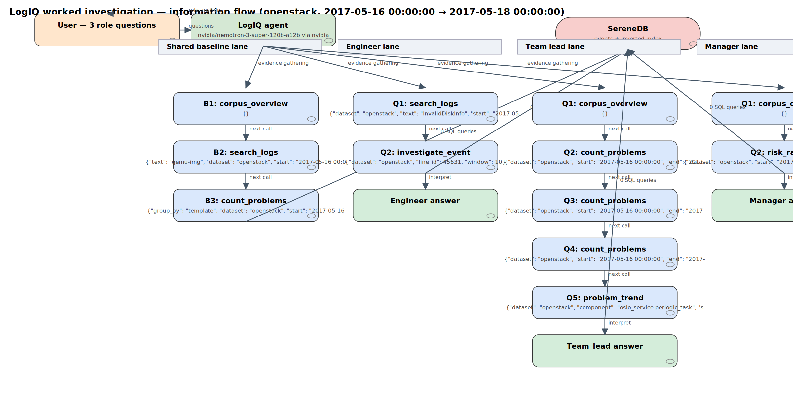
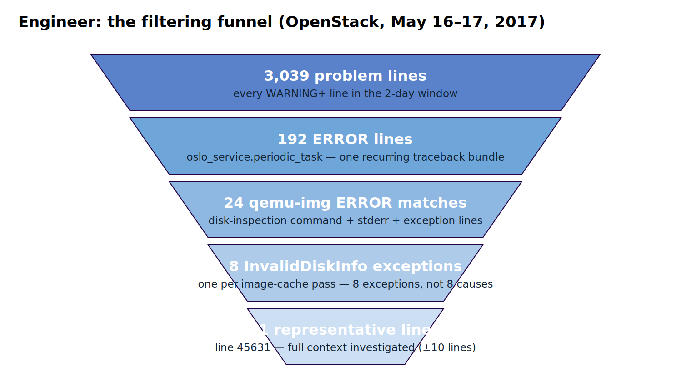
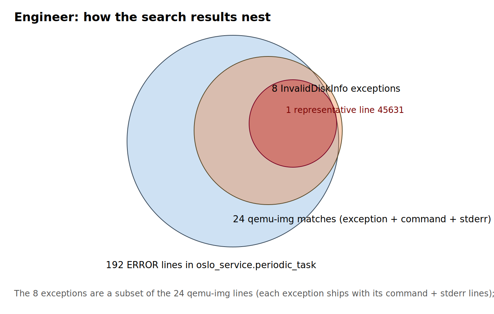
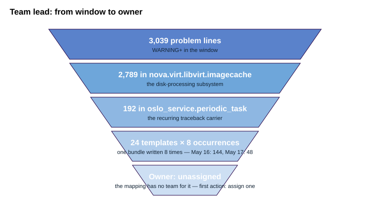
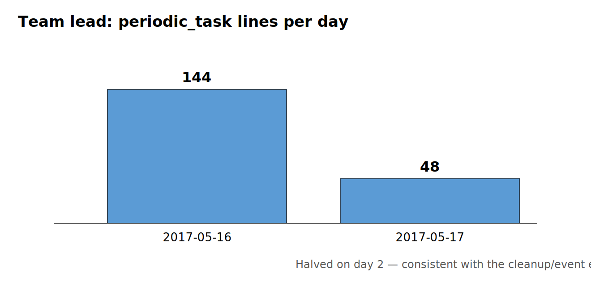
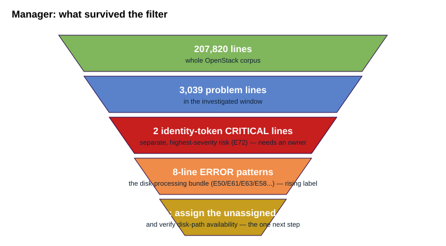
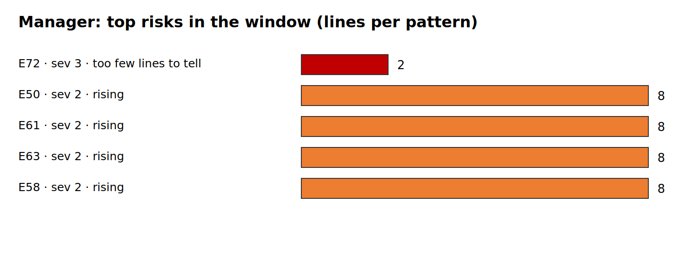

# One Pattern, Three Perspectives — the visual report

**LogIQ · National AI Hackathon 2026 · SereneDB challenge**
Dataset: **OpenStack** · Window: **May 16–17, 2017** · Model: nvidia/nemotron-3-super-120b-a12b

Every number below comes from an executed query recorded in [`evidence.jsonl`](evidence.jsonl).
The full machine trace: [flow_chart.json](flow_chart.json) · rendered flow: [flow_chart.png](flow_chart.png)

---

## The whole story in one picture

*Three questions → one agent → 19 available tools → the agent picked 11 tool calls → parameterised SQL in
SereneDB → limited evidence back → three role answers.*

---

## Engineer — *what went wrong?*

**Result (3 bullets):**

- `InvalidDiskInfo: Disk info file is invalid: qemu-img failed to execute on …/16797a0f…/disk`
- The command's own stderr: exit code **1**, *"No such file or directory"* — a missing path, not disk corruption
- A lifecycle lead: the same instance was destroyed on the hypervisor **0.1 s later**; an "Unknown base file"
  warning appeared **35 s earlier**

**Next check:** correlate instance deletion with image-cache cleanup timing; verify the disk path at error time.

---

## Team lead — *how often, and who owns it?*

**Result (3 bullets):**

- The bundle lives in **oslo_service.periodic_task**: 192 ERROR lines = **24 templates × 8 passes**
- Day 1: **144** lines → Day 2: **48** — the event *ended*, it did not grow
- Owner in the mapping: **unassigned** — first action: assign the subsystem to a team

---

## Manager — *what deserves attention?*

**Result (3 bullets):**

- **2 CRITICAL** identity-token lines (E72) — highest severity, separate issue, needs an owner
- The disk-processing pattern (E50/E61/E63/E58, 8 lines each) — labelled **rising** but "too few lines to tell" is honest
- One action covers both: **assign owners** and verify disk-path availability at error time

---

## What this investigation established — and what it didn't

| Established by evidence | Still unknown |
|---|---|
| 8 exception occurrences ≠ 8 incidents (they share one bundle shape) | Why the disk path was missing |
| The event halved on day 2 (144 → 48) | Whether cleanup raced the cache manager |
| Owner is unassigned in the mapping | Any customer or business impact |

> Full narrative version: [submission_report_with_summary.md](submission_report_with_summary.md) ·
> raw evidence: [evidence.jsonl](evidence.jsonl) · regenerate everything: `python make_visuals.py`
